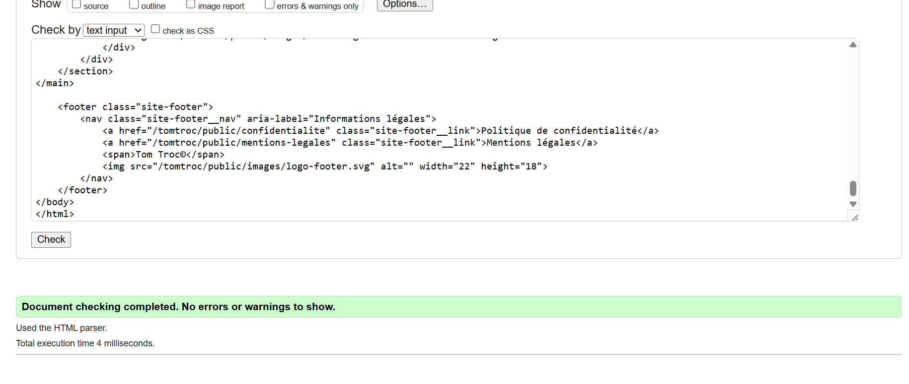

# Validation W3C

Le validateur du W3C vérifie que le code HTML d'une page respecte la norme : balises bien fermées et bien imbriquées, attributs autorisés, pas d'identifiant en double, etc.

## Comment j'ai fait

Le site tourne en local (`localhost`), le validateur en ligne ne peut donc pas y accéder directement. J'ai copié le code de la page :

1. Ouvrir la page dans le navigateur, par exemple http://localhost/tomtroc/public/
2. Afficher le code source avec `Ctrl + U` (c'est le HTML généré par PHP)
3. Tout copier (`Ctrl + A` puis `Ctrl + C`)
4. Aller sur https://validator.w3.org/#validate_by_input (onglet « Validate by Direct Input »)
5. Coller le code et cliquer sur « Check »

Pour les pages où il faut être connecté (Mon compte, la messagerie…), je me connecte d'abord, puis je fais `Ctrl + U` sur la page.

Pour le CSS, c'est la même chose avec le validateur CSS : https://jigsaw.w3.org/css-validator/#validate_by_input, en collant le contenu de `public/css/style.css` (profil « CSS niveau 3 »).

## Exemple : la page d'accueil

Résultat : aucune erreur.

J'ai fait la même vérification sur les autres pages du site (Nos livres, détail d'un livre, profil, connexion, inscription, Mon compte, messagerie, page 404) : aucune erreur.
