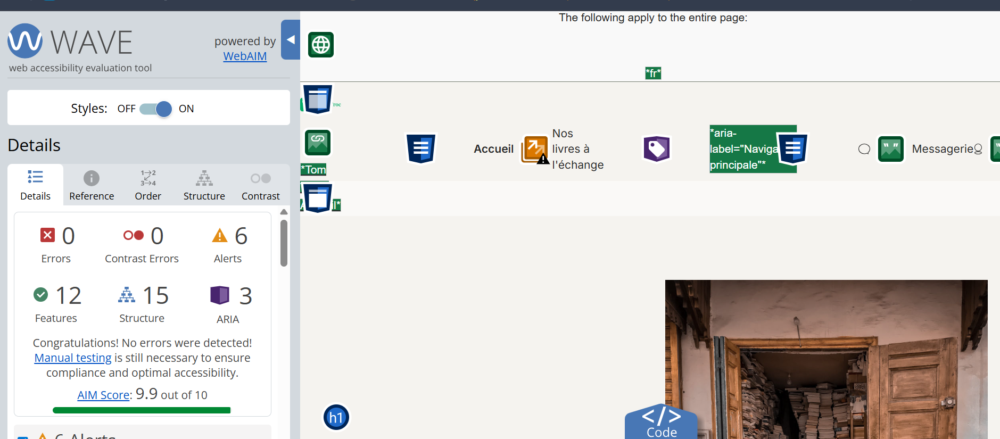

# Validation de l'accessibilité (WCAG)

Le WCAG regroupe les règles d'accessibilité du web : le site doit être utilisable par tout le monde, y compris avec un lecteur d'écran, au clavier, ou quand on voit mal. Le niveau visé est le niveau AA.

## Comment j'ai fait

J'ai utilisé WAVE, une extension gratuite pour le navigateur (https://wave.webaim.org/extension/) :

1. Ouvrir une page du site, par exemple http://localhost/tomtroc/public/
2. Cliquer sur l'icône de WAVE
3. Regarder le résumé à gauche : les « Errors » et les « Contrast Errors » doivent être à 0 (les « Alerts » sont des avertissements)

## Correction faite

Au premier test, WAVE signalait des erreurs de contraste : les gris et les verts de la maquette étaient trop clairs par rapport au fond (contraste inférieur à 4,5, le minimum du niveau AA). J'ai foncé légèrement ces couleurs dans les variables CSS de `style.css`, en gardant la même teinte :

| Couleur | Maquette | Après correction |
|---|---|---|
| Gris des textes | `#A6A6A6` | `#6E6E6E` |
| Vert des boutons | `#00AC66` | `#007E4B` |
| Badge « disponible » | `#6DC5A1` | `#348363` |
| Badge « non dispo. » | `#C56D6D` | `#BC5757` |

## Exemple : la page d'accueil

Résultat : 0 erreur et 0 erreur de contraste. Le score AIM de WAVE passe de 5,4/10 avant la correction des couleurs à 9,9/10. Les 6 « Alerts » restantes sont des avertissements (par exemple le logo et le lien « Accueil » qui mènent à la même page).

